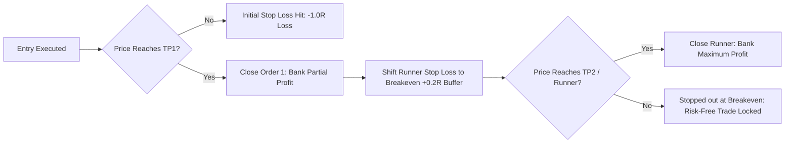

# ApexHunter 2.0 Institutional Multi-Asset Trading System — Master Project Documentation

> **System Name:** ApexHunter 2.0 (Institutional Flagship Unified Bot)  
> **Repository:** `RyzEnHunTer/apexhunter`  
> **Workspace Root:** `D:\FOREX\FOREX`  
> **Core Package Directory:** `D:\FOREX\FOREX\lk_system`  
> **Target Execution Environment:** MetaTrader 5 (Windows VPS / Dedicated Server)  
> **Supported Broker Programs:** FTMO, The5ers, Funding Pips, Alpha Capital, TopTier, IC Markets, Pepperstone  
> **Status:** Production-Ready & Locked (100% Passing Tests: 95/95 Verified)

---

## 1. Executive Summary & Strategy Identity

**ApexHunter 2.0** is an institutional-grade, multi-asset algorithmic execution engine engineered for MetaTrader 5. It is specifically designed to pass prop firm evaluation challenges (e.g., The5ers, FTMO, Funding Pips) with high velocity while maintaining strict capital preservation and zero drawdown breaches during funded bi-weekly payout cycles.

ApexHunter 2.0 unifies two battle-tested trading paradigms running **simultaneously in parallel (no mode-switching, no market analyser interference)** across 8 live markets:

1. **ApexHunter Commodity & Index Engine (M5 Closed Candles):**
   - Assets: Gold (`XAUUSD`) & Nasdaq (`NAS100`)
   - Architecture: Directional Candle Confirmation with TripleGuard Volatility Shields, Session VWAP anchoring, 5M Turtle Soup liquidity sweeps, and Smart Killzone time gates.
2. **ApexHunter Smart Money Forex Engine (M15 Closed Candles):**
   - Assets: 6 Major/Cross Currency Pairs (`EURUSD`, `GBPUSD`, `AUDUSD`, `USDJPY`, `EURJPY`, `USDCAD`)
   - Architecture: Multi-Timeframe Smart Money Concepts (SMC), Asian Range (00:00–06:00 UTC) liquidity sweeps during London/NY overlap, Fair Value Gaps (FVG), and Order Block mitigations.
3. **Institutional Defense & Guardian Suite:**
   - Risk Guardian (Daily 5% DD & Max 10% Floor Circuit Breakers, Fitted Risk Scaling, Max 2 Losses/Symbol/Day).
   - Dynamic Asset Handler (4-stage fuzzy symbol discovery across differing broker suffixes/prefixes).
   - Atomic Persistence Manager (Fault-tolerant crash recovery, multi-split position reconciliation, runner BE verification).
   - Spread Guardian & High-Impact News Guardian (ForexFactory automated embargoes).
   - Decoupled Asynchronous Telemetry (Telegram & Discord alerts via non-blocking producer-consumer thread queue).

---

## 2. Repository Layout & Directory Structure

To maintain compatibility with established module imports and test suites, the project is structured as follows:

```
D:\FOREX\FOREX/
├── run_apexhunter_2.py                 # Primary Root Launcher (CLI entry point for ApexHunter 2.0)
├── run_bot.py                         # Convenience redirect to run_apexhunter_2.py
├── PROJECT_DOCUMENTATION.md           # Master Strategy & System Specification (Single Source of Truth)
├── PROJECT_RULES.md                   # Core Development Protocols & AI Agent Invariants
├── SYSTEM_LOCK.md                     # Immutable Production Parameter Lock Registry
├── README.md                          # Quick Start, Installation & Execution Guide
├── requirements.txt                   # Production Python Dependencies
├── lk_system/                         # Core Production Package Directory
│   ├── master_live_bot.py             # Central Bot Orchestrator & Live Surveillance Daemon
│   ├── dcc_engine_v1_2.py             # ApexHunter Engine Re-export Shim
│   ├── start_master_bot.bat           # 1-Click Interactive Console Launcher
│   ├── core/                          # Core Algorithmic & Guardian Modules
│   │   ├── apexhunter_engine.py       # ApexHunter v1.2.1 TripleGuard Engine
│   │   ├── asset_handler.py           # 4-Stage Broker Symbol Auto-Resolver & Market Watch Manager
│   │   ├── persistence_manager.py     # Atomic State Serialization & MT5 Ticket Reconciler
│   │   ├── mt5_live_bridge.py         # Microsecond MT5 IPC Bridge with Auto-Reconnect Watchdog
│   │   ├── risk_guardian.py           # Prop Firm Circuit Breaker & Fitted Risk Engine
│   │   ├── spread_guardian.py         # Spread Caps & 30% SL Distance Gate
│   │   ├── news_guardian.py           # Automated Economic Calendar Embargo Shield
│   │   ├── market_structure.py        # Swing High/Low & Fractal Break of Structure (BOS)
│   │   ├── imbalance.py               # Fair Value Gap (FVG) Detection
│   │   └── dealing_range.py           # Premium vs. Discount Equilibrium Mapping
│   ├── backtest/                      # Institutional Backtesting & Replay Engines
│   │   ├── unified_backtest_engine.py # 1-to-1 Live Parity Portfolio Backtest Engine
│   │   ├── nightly_reconciler.py      # Automated MT5 Deal Reconciler & Telemetry Dispatcher
│   │   └── test_forex_basket_fixed_risk.py # Forex Basket Fixed Risk Simulation
│   ├── live/                          # Live Execution Infrastructure
│   │   ├── notifier.py                # Asynchronous Telegram & Discord Telemetry Engine
│   │   └── order_manager.py           # Multi-Split MT5 Order Execution & Breakeven Monitor
│   ├── logs/                          # Runtime State, Audit Logs & Telemetry
│   │   ├── bot_runtime_state.json     # Live Atomic JSON State Snapshot
│   │   ├── bot_accounts_config.json   # Multi-Account Lifecycle & Challenge Target Config
│   │   └── market_calculations_*.csv  # 37-Column Tick & Bar Calculation Audit Trail
│   ├── scripts/                       # Operational Simulation & Verification Scripts
│   │   └── simulate_canonical_propfirm_challenge.py # 2-Phase Challenge & Payout Simulator
│   ├── tests/                         # Automated Test Suite (95 Tests, 100% Green)
│   └── tick_cache/                    # 10.5-Month High-Resolution Parquet Candle Cache
```

> **Why is there an `lk_system/` directory?**  
> The repository originated during the development of the Lewis Kelly SMC Forex architecture (`lk_system`). When ApexHunter v1.2.1 was integrated to form the unified multi-asset engine, the core components were housed inside `lk_system/` to preserve import hierarchy and avoid cyclic dependency breakage. The top-level launcher [`run_apexhunter_2.py`](file:///D:/FOREX/FOREX/run_apexhunter_2.py) allows running the bot directly from the repository root.

---

## 3. Strategy Specification & Mathematical Formulas

### 3.1 ApexHunter Commodity & Index Engine (Gold & Nasdaq)

* **Execution Timeframe:** 5-Minute (M5) Closed Bars.
* **Macro Trend Filter:** 1-Hour (H1) Closed Bars.
  - H1 EMA Fast (9-period) vs. H1 EMA Slow (20-period):
    $$\text{Bias}_{1H} = \begin{cases} +1 \text{ (Bullish)}, & \text{EMA9}_{1H} > \text{EMA20}_{1H} \\ -1 \text{ (Bearish)}, & \text{EMA9}_{1H} < \text{EMA20}_{1H} \\ 0 \text{ (Neutral)}, & \text{otherwise} \end{cases}$$
* **Session Anchor:** True Session Volume-Weighted Average Price (VWAP), reset daily at 00:00:00 UTC:
  $$\text{VWAP}_t = \frac{\sum_{i=1}^t P_{\text{typical}, i} \cdot V_i}{\sum_{i=1}^t V_i}, \quad P_{\text{typical}} = \frac{\text{High} + \text{Low} + \text{Close}}{3}$$
* **TripleGuard Volatility Shields (Anti-Chop, Anti-Exhaustion, Anti-Chase):**
  1. **Shield 1: 1H Stretch Guard (Anti-Chop Floor):**
     $$\text{Stretch Ratio} = \frac{|\text{Close}_{5M} - \text{EMA20}_{1H}|}{\text{ATR}_{1H}} \ge 0.40$$
     *(Blocks entries when price is compressed against the 1H EMA20 in flat range chop).*
  2. **Shield 2: 1H ADX Ceiling (Anti-Exhaustion):**
     $$\text{ADX}_{1H}(14) \le 45.0$$
     *(Blocks buying the late-stage blow-off top or shorting the parabolic capitulation bottom).*
  3. **Shield 3: 5M No-Chase Guard:**
     $$\text{Chase Ratio} = \frac{|\text{Close}_{5M} - \text{EMA9}_{5M}|}{\text{ATR}_{1H}} \le 0.50$$
     *(Blocks entering extended spike candles too far away from the 5M EMA9).*
  4. **Shield 4: Low-ADX Quality Gate (v1.2.1 Upgrade):**
     $$\text{If } \text{ADX}_{1H} < 20.0 \implies \text{Stretch Ratio} \ge 0.90$$
     *(Filters out sluggish low-volume consolidation while preserving massive runner expansions).*
* **5M Turtle Soup Liquidity Grab (Liquidity Sweep):**
  - Scans candidate fractal swing pivots across lookback window $[idx - 24 : idx - 3]$.
  - Pullback window $[idx - 3 : idx]$ must penetrate beyond the swing level.
  - Entry bar close MUST reject and close back inside the prior range.
* **Smart Killzone Time Gates:**
  - London 09:00 UTC and NY 13:00 UTC are permitted **only if** $\text{Stretch Ratio} \ge 1.10$.
  - Monday Post-Lunch Deadzone (14:00–17:00 UTC) is strictly blocked.

### 3.2 ApexHunter Smart Money Forex Engine (Forex Basket)

* **Execution Timeframe:** 15-Minute (M15) Closed Bars.
* **Macro Trend Filter:** 4-Hour (H4) Market Structure.
* **Asian Session Range Liquidity Model:**
  - Range Definition: Session High and Low established between **00:00:00 and 06:00:00 UTC**.
  - Sweep Window: Price must sweep the Asian High (for Short) or Asian Low (for Long) during active London (08:00–12:00 London time) or New York (08:00–13:00 NY time).
  - Validation: Entry occurs upon Fair Value Gap (FVG) formation or Order Block mitigation following the sweep.
* **No-Trade Dead Zones:**
  - Asian Range Formation (20:00–06:00 UTC): Blocked.
  - Friday Evening Close (20:00 UTC): Automatic risk de-leveraging before weekend market closure.

---

## 4. Multi-Split Trade Management & Breakeven Protection

Every position is dispatched as a multi-split order group on the MT5 terminal to guarantee risk elimination upon reaching Target 1:



### Parameter Matrix by Asset

| Asset Class | Symbols | Split Structure | TP1 (Partials) | TP2 / TP3 (Runners) | Breakeven Trigger | SL Multiplier | Max Spread |
| :--- | :--- | :---: | :---: | :---: | :---: | :---: | :---: |
| **Commodity** | `XAUUSD` | 2-Split (50% / 50%) | +1.40R | +2.20R | TP1 Hit $\rightarrow \text{Entry} + 0.2\text{R}$ | $0.90 \times \text{ATR}$ | $0.65 pts |
| **Index** | `NAS100` | 2-Split (50% / 50%) | +1.40R | +2.10R | TP1 Hit $\rightarrow \text{Entry} + 0.2\text{R}$ | $1.40 \times \text{ATR}$ | $7.00 pts |
| **Forex** | `EURUSD`, `GBPUSD` | 3-Split (30%/30%/40%) | +2.50R | +5.00R / +8.00R | TP1 Hit $\rightarrow \text{Entry} + 0.2\text{R}$ | Structural Sw | $2.2–2.5 pips |
| **Forex** | `USDJPY`, `EURJPY` | 3-Split (30%/30%/40%) | +2.50R | +5.00R / +8.00R | TP1 Hit $\rightarrow \text{Entry} + 0.2\text{R}$ | Structural Sw | $2.0–3.0 pips |
| **Forex** | `AUDUSD`, `USDCAD` | 3-Split (30%/30%/40%) | +2.50R | +5.00R / +8.00R | TP1 Hit $\rightarrow \text{Entry} + 0.2\text{R}$ | Structural Sw | $2.5–2.8 pips |

---

## 5. Prop Firm Risk Management & Circuit Breakers

The Risk Guardian ([`core/risk_guardian.py`](file:///D:/FOREX/FOREX/lk_system/core/risk_guardian.py)) enforces prop-firm compliance:

### 5.1 Daily Drawdown Rule (The5ers & FTMO Parity)
- **Reset Time:** Strictly evaluated at **00:00 MT5 Server Time** (EET / UTC+2 or UTC+3), not UTC midnight.
- **Starting Benchmark Anchor:**
  $$\text{Anchor}_{00:00} = \max(\text{Balance}_{00:00}, \text{Equity}_{00:00})$$
  *(Floating profits at midnight expand the anchor; floating losses do not lower the anchor below balance).*
- **Daily Drawdown Limit:** 5.0% from Anchor ($250 on $5k, $500 on $10k).
- **Internal Safety Circuit Breaker:** Set at **4.0%** ($200 on $5k, $400 on $10k). When daily drawdown hits 4.0%, all active orders are closed, and trading is halted until the next server midnight.

### 5.2 Maximum Trailing/Static Drawdown Floor
- **Limit:** 10.0% from initial base capital ($4,500 floor on $5k, $9,000 floor on $10k).
- **Dynamic Fitted Risk Clamping:**
  $$\text{Remaining Room} = \text{Current Equity} - \text{Floor}$$
  $$\text{Next Trade Risk} = \min(\text{Normal Risk}, \text{Remaining Room} \times 0.70)$$
  *(If the account dips near the floor, position sizing is automatically reduced to prevent any single trade from breaching the limit).*

### 5.3 Symbol Loss Limiter
- **Max Consecutive Losses:** Hard ceiling of **2 losses per symbol per day**. If Gold or Nasdaq takes 2 losses in a session, that symbol is disabled until the next day.

---

## 6. Empirical Verification & Out-Of-Sample Benchmark

Tested on 10.5 months of institutional data (January 02, 2026 – November 09, 2026, **512 verified trades**):

```
========================================================================================
                      APEXHUNTER 2.0 BENCHMARK SCORECARD
========================================================================================
Dataset Scope:               January 02, 2026 to November 09, 2026 (10.5 Months)
Total Executed Trades:       512 Trades
  - ApexHunter (Gold & Nas): 359 Trades (59.1% Win Rate, +$10,521.05 Net PnL)
  - Lewis Kelly SMC Forex:   153 Trades (47.1% Win Rate, +$8,370.00 Net PnL)
Combined Portfolio Return:   +$18,891.05 (+377.8% Net on $5k Base)

2-Phase Prop Firm Challenge (Dynamic 1.0% Risk):
  - Phase 1 (+10% Target):   PASSED in 8 Trades (January 06, 2026)
  - Phase 2 (+5% Target):    PASSED in 8 Trades (January 09, 2026)

Live Funded Phase (Bi-Weekly 14-Day Payout Resets):
  - Payout Cycles:           22 Cycles (21 Profitable Payouts / 1 Non-Payout Carryover)
  - Total Profit Cashed Out: $19,936.82 (100% Net Profit)
  - Trader Payout (80%):     $15,949.46 in Banked Cash ($31,898.92 on $10k Account)
  - Worst Single Day:        -$196.65 (3.93% loss vs. 5.0% limit -> $53.35 Safety Cushion)
  - Max Drawdown from Base:  5.29% ($4,735.47 lowest balance vs. $4,500 Floor -> $235.47 Cushion)
  - Drawdown Breach Status:  100% ZERO BREACH (Zero account terminations across 10.5 months)
========================================================================================
```

---

## 7. Operational Runbook & Execution Commands

### 7.1 Running from Repository Root
```powershell
# 1. Interactive Console Menu (Default)
python run_apexhunter_2.py

# 2. Live MT5 Order Execution Mode (Auto-confirm)
python run_apexhunter_2.py --live --auto

# 3. Dry-Run Real-Time Paper Trading (Market surveillance without real orders)
python run_apexhunter_2.py --dry-run --auto

# 4. Custom Starting Capital Override
python run_apexhunter_2.py --live --capital 10000.0 --risk 0.01
```

### 7.2 Running Automated Verification Suite
```powershell
python -m unittest discover lk_system/tests
```
*(All 95 unit and integration tests must pass before deploying to live accounts).*
